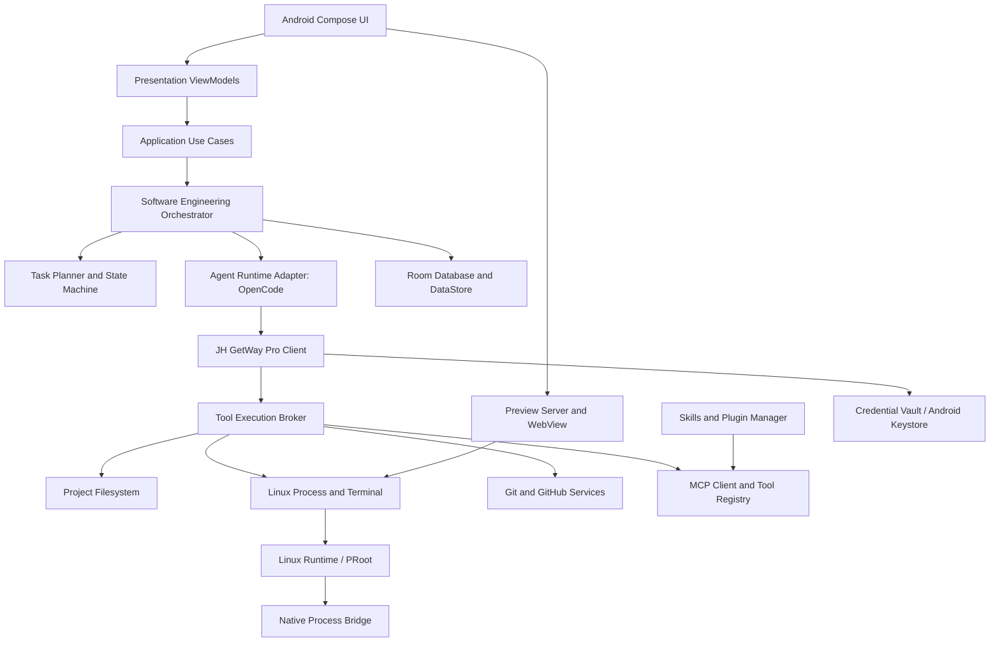

# 03 — AGT Code System Architecture

**Status:** Proposed architecture based on the approved product requirements and supplied source audits.

## 1. Architecture principles

1. Reuse JH GetWay Pro as the AI connectivity layer.
2. OpenCode is the first Agent Runtime.
3. Keep Android UI, orchestration, runtime execution, and gateway communication behind explicit interfaces.
4. Treat the Linux environment as an execution environment, not as the agent's source of truth.
5. Git is the version-control source of truth for repository changes.
6. Do not allow model output to directly bypass tool authorization.
7. Make task execution observable, cancellable, checkpointed, and recoverable.
8. Keep future Agent Runtimes pluggable without rewriting the workspace UI.

## 2. Logical component diagram



This is a proposed logical architecture. Concrete process boundaries and transport protocols must be decided during implementation.

## 3. Android application layers

### 3.1 Presentation
- Jetpack Compose screens and reusable components.
- Navigation and state collection.
- UI state must represent real operation states, not fabricated success.

### 3.2 Presentation state
- ViewModels expose immutable UI state and events.
- Do not place shell execution, network requests, or long-running orchestration directly inside Composables.

### 3.3 Domain / application
Suggested use cases:
- CompleteFirstRunSetup
- ConnectGateway
- ConnectGitHub
- CreateProject
- CloneRepository
- OpenProject
- SubmitAgentTask
- StopAgentTask
- ApproveToolAction
- ReadProjectTree
- ExecuteTerminalCommand
- StartPreviewServer
- InstallExtension
- UpdateSettings

### 3.4 Data / infrastructure
- Room for project metadata, tasks, sessions, checkpoints, extension metadata, and logs.
- DataStore for non-secret preferences.
- Android Keystore-backed credential protection.
- Gateway HTTP/SSE client.
- Linux runtime installer and process bridge.
- Git and GitHub integration.
- Extension and MCP clients.

## 4. Core services and interfaces

Define interfaces before implementations:

```kotlin
interface GatewayClient {
    suspend fun health(): GatewayHealth
    suspend fun listModels(): List<GatewayModel>
    fun streamChat(request: GatewayChatRequest): Flow<GatewayStreamEvent>
}

interface AgentRuntime {
    val id: String
    suspend fun checkAvailability(): RuntimeAvailability
    suspend fun startSession(project: ProjectRef): AgentSession
    fun submitTask(session: AgentSession, task: AgentTask): Flow<AgentEvent>
    suspend fun stop(session: AgentSession)
}

interface RuntimeExecutor {
    suspend fun ensureReady(): RuntimeStatus
    fun execute(command: RuntimeCommand): Flow<ProcessEvent>
    suspend fun terminate(processId: String)
}

interface ProjectFileStore {
    suspend fun list(path: ProjectPath): List<ProjectEntry>
    suspend fun read(path: ProjectPath): ByteArray
    suspend fun write(path: ProjectPath, content: ByteArray)
    suspend fun delete(path: ProjectPath)
}

interface CheckpointManager {
    suspend fun create(projectId: String, reason: String): Checkpoint
    suspend fun diff(checkpointId: String): ProjectDiff
    suspend fun restore(checkpointId: String)
}
```

The signatures are illustrative contracts; refine types and error models before coding.

## 5. Data ownership

- **Gateway:** upstream provider keys, model routing, provider telemetry, gateway device credentials.
- **AGT app:** project metadata, task state, approvals, settings, extension registry state, UI preferences.
- **Linux runtime:** actual working tree, installed tools, running processes, local development servers.
- **GitHub:** remote repository, branches, commits, pull requests, and remote history.
- **Agent runtime:** session and protocol-specific state, mirrored as needed by AGT for recovery and display.

## 6. Process and communication boundaries

- Android UI communicates with application services through ViewModels/use cases.
- Agent runtime integration communicates through a dedicated adapter.
- Linux command execution goes through RuntimeExecutor, never through arbitrary UI callbacks.
- Gateway calls go through a typed GatewayClient.
- MCP calls go through a permission-aware Tool Broker.
- Long-running operations use Android-appropriate foreground execution.
- Local service binding must use authenticated, least-privilege IPC where applicable.

## 7. Suggested module structure

```text
app/
  core/
    common/
    security/
    database/
    network/
    design/
  feature/
    setup/
    github/
    home/
    workspace/
    agent/
    files/
    terminal/
    preview/
    extensions/
    settings/
  domain/
    model/
    repository/
    usecase/
  data/
    gateway/
    project/
    agent/
    runtime/
    github/
    extensions/
    mcp/
  runtime/
    installer/
    process/
    terminal/
    preview/
  agent/
    orchestrator/
    protocol/
    opencode/
    tools/
  extension/
    skills/
    mcp/
    plugins/
```

## 8. Error model

Every boundary should return typed failures, such as:
- NetworkUnavailable
- GatewayUnauthorized
- GatewayModelUnavailable
- UnsupportedCapability
- RuntimeNotInstalled
- RuntimeIncompatible
- ProcessStartFailed
- ProcessTimedOut
- ProcessCancelled
- PermissionDenied
- ApprovalRequired
- ProjectPathRejected
- CheckpointFailed
- ExtensionSignatureOrIntegrityFailure

Errors must preserve safe diagnostic context without leaking secrets.
