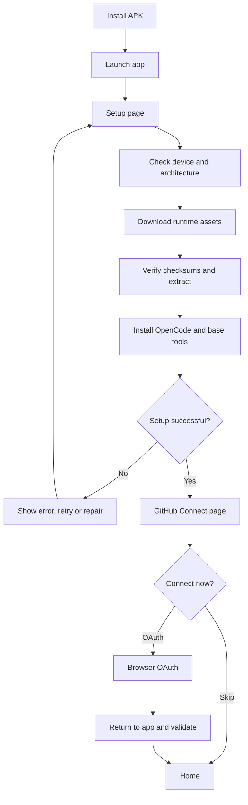
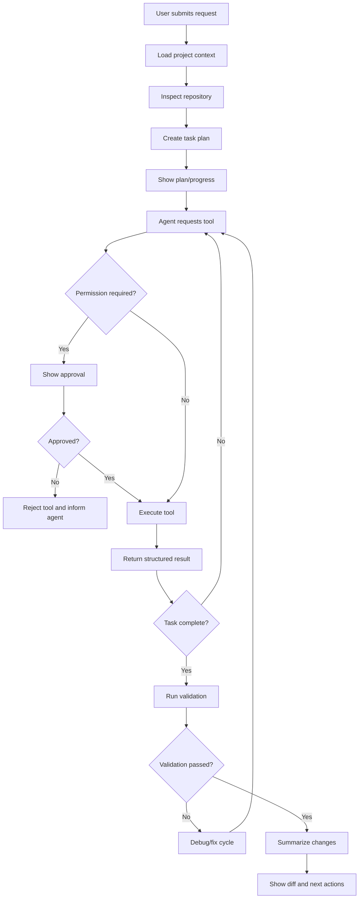

# 04 — User Workflows

## 1. First launch

### Setup page requirements
- First launch opens Setup.
- Normal end users press **Install Runtime** directly without entering a Runtime Manifest URL (`AGT_RUNTIME_MANIFEST_URL` is resolved from `AgtAppConfig` / `BuildConfig`).
- APK should remain relatively small; large runtime assets are fetched after installation.
- Show per-component state: waiting, downloading, verifying, extracting, installing, completed, failed.
- Show progress bytes/total when available.
- Detect device ABI (`arm64-v8a`, `x86_64`, etc.), select the matching runtime bundle, and verify SHA-256 integrity before extraction.
- Allow retry, resume, and safe recovery; surface an actionable configuration error if official build config is missing.
- Do not report installation complete until runtime health checks pass.

## 2. GitHub connect

- Explain why GitHub is requested.
- Normal end users tap **Connect GitHub** without entering a Client ID, Client Secret, or Personal Access Token (`AGT_GITHUB_OAUTH_CLIENT_ID` is injected via build configuration).
- Start OAuth Authorization Code Flow with PKCE (`code_challenge_method=S256` and CSRF `state`) in the system browser or Custom Tab—never embedding an OAuth Client Secret in the APK.
- Handle `agtcode://oauth/github` deep-link callback safely and exchange the authorization code with PKCE `code_verifier`.
- Validate the resulting credential and minimum scopes, storing tokens only in `GitHubCredentialVault` (Android Keystore).
- Permit Skip and allow later connect, disconnect, and reconnect under Settings → GitHub.

## 3. Home

Home contains:
- Create Project
- Recent Projects

Create Project:
1. Enter project name.
2. Validate allowed characters and path.
3. Create workspace directory and project metadata.
4. Open Project Workspace.

Existing project:
1. Choose local project or GitHub repository.
2. Clone or import with visible progress.
3. Validate repository root.
4. Open Project Workspace.

## 4. Project Workspace

Four compact horizontal selectors:
- Agent
- Files
- Terminal
- Preview

Agent is the default tab.

### Agent task workflow

## 5. Agent composer

- Compact by default.
- Expands vertically as text grows.
- Plus menu contains Camera, Image, File, Skills, MCP Servers, Plugins.
- Separate model selector beside the plus button.
- Send action inside composer.
- Model options come from live gateway model discovery.
- Display selected model and capability warnings where relevant.

## 6. Files

- Show project-root tree.
- Support navigation, file open, create/edit, rename, delete, and diff.
- Use project-root path confinement.
- Refresh after agent operations.
- Confirm destructive operations.

## 7. Terminal

- Show session output in a compact terminal view.
- Support multiple sessions where feasible.
- Stream stdout/stderr.
- Show process status and exit code.
- Provide Stop/Terminate.
- Keep terminal process associated with its project.
- Ask approval for risky commands according to policy.

## 8. Preview

- Start or detect a development server.
- Display local URL and server status.
- Load in built-in browser.
- Provide reload and stop-server controls.
- Surface console/build errors where technically available.
- Do not assume every framework uses port 3000; discover or let user choose.

## 9. Extensions

App-level bottom navigation contains Home, Extensions, Settings.

Extensions screen has three categories:
- Skills
- MCP Servers
- Plugins

Each item should have detail/inspection, source, version, compatibility, permissions, install state, enable/disable, update, and uninstall actions.

## 10. Settings

Settings home is a vertical list only:
1. Gateway
2. GitHub
3. Agent
4. Runtime
5. Models
6. Security
7. Appearance
8. Notifications
9. Storage
10. About

Tapping a row navigates to a dedicated detail page. The list must not remain visible in a side panel beside the detail page. Back returns to the Settings list.

## 11. Global navigation rules

- App-level navigation: Home, Extensions, Settings.
- Workspace navigation: Agent, Files, Terminal, Preview.
- Do not combine these two navigation systems.
- Do not place a separate theme toggle in Project Workspace.
- Theme is controlled by Settings → Appearance.
